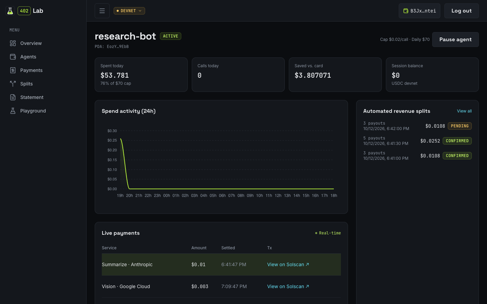
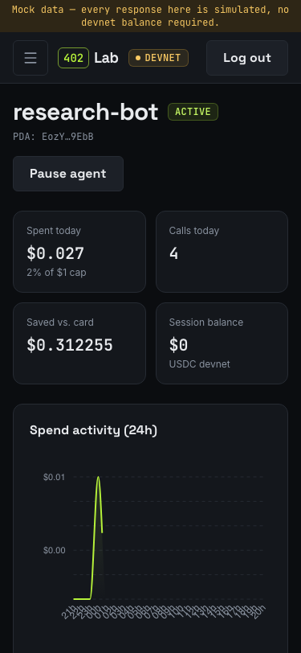
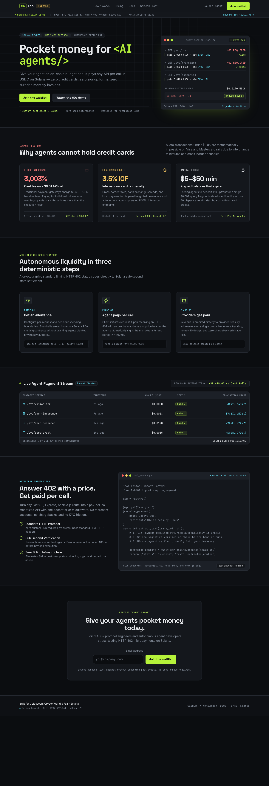
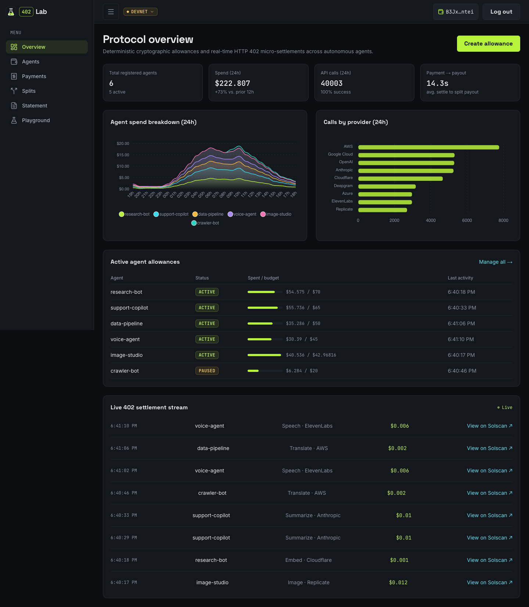
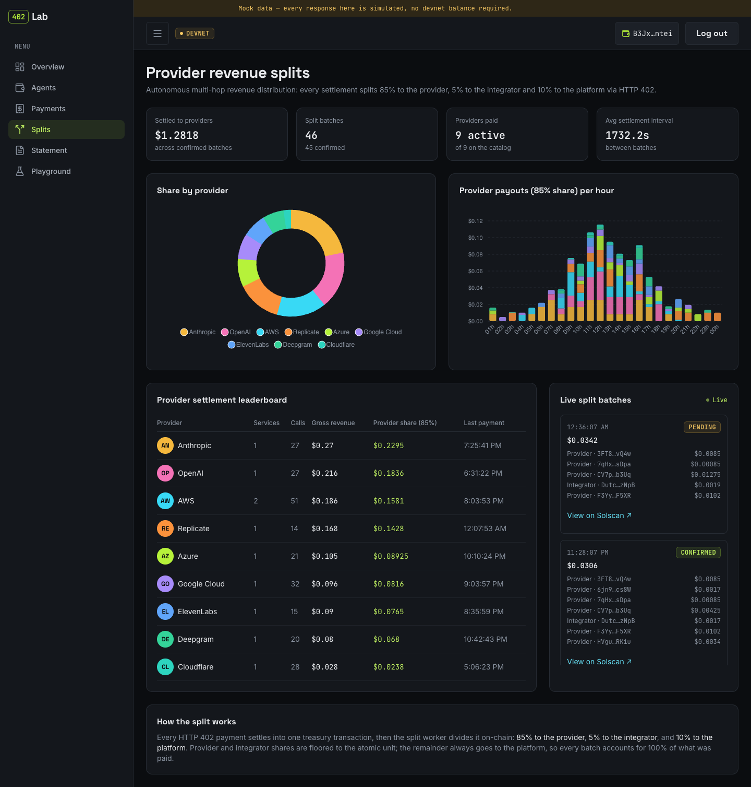
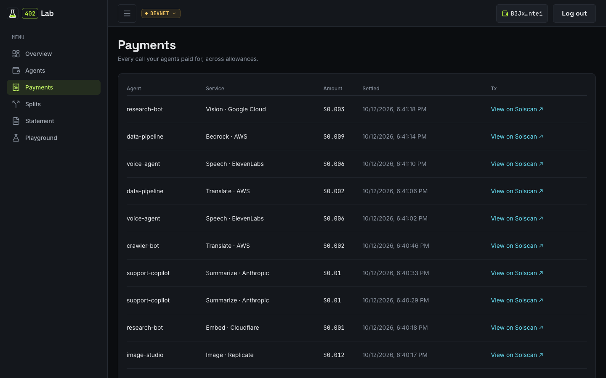
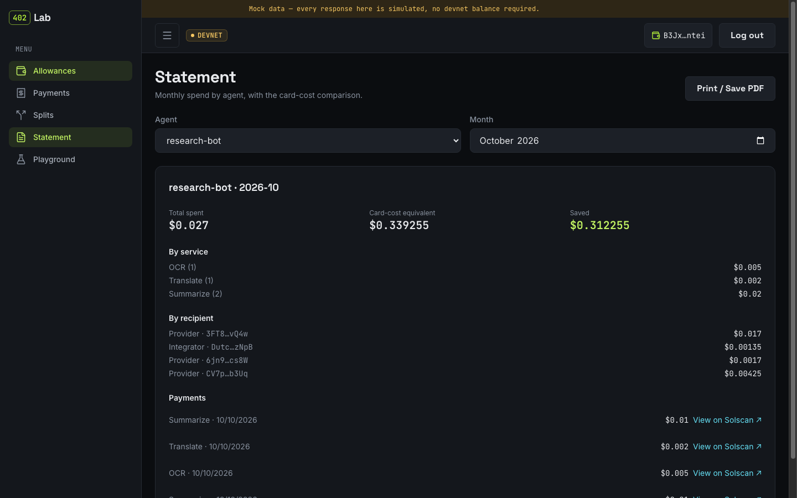
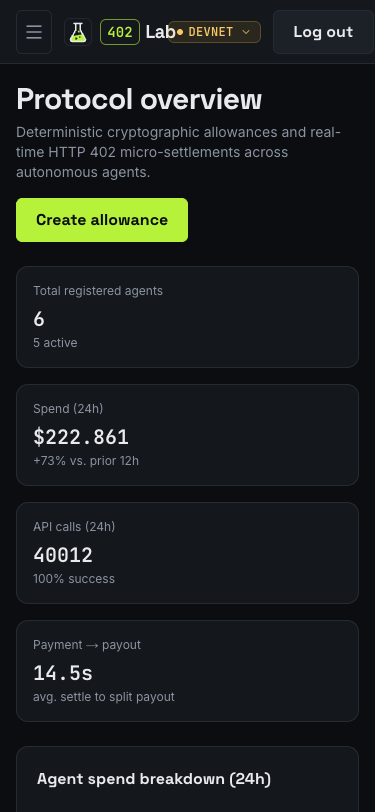

<p align="center">
  <picture>
    <source media="(prefers-color-scheme: dark)" srcset="docs/design/brand/logo-horizontal-dark.png">
    
  </picture>
</p>

<p align="center"><b>The spending account for AI agents.</b><br>
Your agents pay for any API, one call at a time, in USDC on Solana.<br>
You set the limits, watch every payment live and stop them with one tap.</p>

<p align="center">
  <a href="https://youtu.be/-d2uFvVrVgs"><b>Pitch video</b></a> ·
  <a href="https://youtu.be/QJJrjnDbFy8"><b>Technical demo</b></a> ·
  <a href="https://web-production-1b5d1.up.railway.app"><b>Live app</b></a> ·
  <a href="https://web-demo-production-0d9a.up.railway.app/app"><b>Demo panel</b></a> ·
  <a href="https://api-production-570e4.up.railway.app/docs"><b>API docs</b></a> ·
  <a href="#on-chain-proof-devnet"><b>On-chain proof</b></a> ·
  <a href="https://github.com/emersonjds/402lab/releases/download/v0.1.0-demo/402lab-demo.apk"><b>Android APK</b></a>
</p>

<div align="center">
<table>
  <tr>
    <td align="right"><b>Status</b></td>
    <td>
      <a href="https://github.com/emersonjds/402lab/actions/workflows/ci.yml"></a>
      <a href="https://github.com/emersonjds/402lab/tags"></a>
      <a href="https://github.com/emersonjds/402lab/releases/download/v0.1.0-demo/402lab-demo.apk"></a>
    </td>
  </tr>
  <tr>
    <td align="right"><b>Solana</b></td>
    <td>
      <a href="https://solana.com/docs"></a>
      <a href="https://www.circle.com/usdc"></a>
      <a href="https://x402.org"></a>
      <a href="https://modelcontextprotocol.io"></a>
    </td>
  </tr>
  <tr>
    <td align="right"><b>API</b></td>
    <td>
      <a href="https://nodejs.org"></a>
      <a href="https://www.typescriptlang.org"></a>
      <a href="https://fastify.dev"></a>
      <a href="https://orm.drizzle.team"></a>
      <a href="https://www.postgresql.org"></a>
      <a href="https://zod.dev"></a>
    </td>
  </tr>
  <tr>
    <td align="right"><b>Web</b></td>
    <td>
      <a href="https://nextjs.org"></a>
      <a href="https://react.dev"></a>
      <a href="https://tailwindcss.com"></a>
      <a href="https://tailadmin.com"></a>
      <a href="https://apexcharts.com"></a>
      <a href="https://mswjs.io"></a>
    </td>
  </tr>
  <tr>
    <td align="right"><b>Mobile</b></td>
    <td>
      <a href="https://docs.expo.dev"></a>
      <a href="https://reactnative.dev"></a>
      <a href="https://docs.expo.dev/eas/"></a>
    </td>
  </tr>
  <tr>
    <td align="right"><b>Tooling</b></td>
    <td>
      <a href="https://docs.npmjs.com/cli/using-npm/workspaces"></a>
      <a href="https://eslint.org"></a>
      <a href="https://prettier.io"></a>
      <a href="https://docs.docker.com/compose/"></a>
      <a href="https://railway.com"></a>
      <a href="https://stitch.withgoogle.com"></a>
    </td>
  </tr>
</table>
</div>

<p align="center">
  
  &nbsp;
  
</p>

# 402Lab

**The spending account for AI agents.** A human gives an agent an allowance, with a cap per call and a cap
per day, and the agent pays every API call by itself in USDC on Solana through HTTP 402
([x402](https://x402.org)). Providers get their share by an automatic split, and the human
watches, pauses and gets one monthly statement.

Built for the Colosseum Crypto World's Fair (Solana track). Runs on **devnet**.

**Live**

- Landing and panel (devnet): https://web-production-1b5d1.up.railway.app
- Panel on demo data (no wallet needed): https://web-demo-production-0d9a.up.railway.app/app
- API and Swagger: https://api-production-570e4.up.railway.app/docs
- Pitch video: https://youtu.be/-d2uFvVrVgs
- Technical demo video: https://youtu.be/QJJrjnDbFy8

## The problem

An agent that needs a paid API (OCR, translation, an LLM) hits a flow built for humans: sign
up, type a card, buy prepaid credit, copy a key, and do it all again for every provider.

- **Cards cannot charge cents.** 2.9% + US$0.30 on a US$0.01 request is a **3,003%** fee; the
  card fee only drops below 10% at about US$4.23 per ticket.
- **Prepaid credit is locked per vendor.** OpenAI: US$5 minimum, expires after one year,
  non-refundable. Every provider is another balance, account and key.
- **Brazil doubles the pain.** 3.5% IOF on every international card purchase (since
  2025-07-17), and about **25%** of Brazilians have no credit card at all (Serasa).
- **Agents are an afterthought.** Only 24% of teams design APIs with agents in mind, and 51%
  fear excessive or unauthorized agent calls (Postman, State of the API 2025).

On-chain the same request costs a fraction of a cent, and x402 already settles it. What is
missing is the **account**: limits a human sets, an agent cannot exceed, and a statement at the
end of the month. Sources in [`docs/research/`](docs/research/).

## Demo in six steps

1. The human connects Phantom on the dashboard and creates a 5 USDC allowance for the agent
   "research-bot": US$0.02 per call, US$1 per day.
2. In Claude (through the 402Lab MCP server) they ask: _"extract the text from this image,
   translate it to English and summarize it"_.
3. The agent discovers the services, gets a 402, and pays three providers on its own, with no
   popup. Dashboard and phone show each payment live, with its Solscan signature.
4. 30 s later one split transaction pays providers, integrator and platform, with a Solscan link.
5. On the phone the human taps **Pause**. The agent's next call is refused.
6. Counter: _"3 calls, US$0.017 paid; by card + IOF they would cost US$0.95"_.

## On-chain proof (devnet)

`npm run e2e:devnet` against the production API on 2026-10-12: an agent session wallet paid each
service through HTTP 402, and the split worker paid providers, integrator and platform in one
transaction.

| Payment                                                       | Price  | Transaction                                                                                                                                |
| ------------------------------------------------------------- | ------ | ------------------------------------------------------------------------------------------------------------------------------------------ |
| OCR · Azure                                                   | $0.005 | [29GrHm3Q…](https://solscan.io/tx/29GrHm3QiHvcysghDZgTowmaHm22sUjo5qunewsDsF9wKdQaUPdnxU3Xw1ReXUydn5dNXGQNPtGaqZ4zudWsh4co?cluster=devnet) |
| Translate · AWS                                               | $0.002 | [3MZ6XPM7…](https://solscan.io/tx/3MZ6XPM7LWc5JLPrN2pCHbMaNaRwQ1Dc5r3LBDpApJER2L98tcRHJLoLpSgaNfJdhhzXKGXTQcZxofdzDYUmzz4B?cluster=devnet) |
| Chat · OpenAI                                                 | $0.008 | [5NoGgg5y…](https://solscan.io/tx/5NoGgg5yuQtdRYFkPQejDJ8jJShq7a779khG8aUr1YxcecKKHBC65q4JTaCZMqDYyc9LVXrZACFcTupddKcnBmzm?cluster=devnet) |
| Speech · ElevenLabs                                           | $0.006 | [298CYBjv…](https://solscan.io/tx/298CYBjvv44x5EAtcUs91RZ92A3KdjeaLcrYXTQGugKwiwh92n2CiVpta6kqwrAg4DHHygvTSui8Qy7hERPAXPVM?cluster=devnet) |
| **Split batch**: providers 85% · integrator 5% · platform 10% |        | [36LqwABG…](https://solscan.io/tx/36LqwABGFN2ZJ7BFEr3BUR9pBkNbjD9kcfYV9nXHdgaUKYDxvc7umyzgXxxanjvf6VFazhky4km6LzrotevYQ8Rn?cluster=devnet) |

## Screens

| Landing                                                                             | Owner overview                                                                                              | Revenue splits                                                                                         |
| ----------------------------------------------------------------------------------- | ----------------------------------------------------------------------------------------------------------- | ------------------------------------------------------------------------------------------------------ |
|      |  |  |
| **Payments**                                                                        | **Monthly statement**                                                                                       | **On a phone**                                                                                         |
|  |             |            |

## How the monorepo works

```
402lab/
├── apps/
│   ├── api/          Fastify 5 + @x402/fastify + Drizzle/Postgres  (port 8080, Swagger at /docs)
│   ├── web/          Next.js 16: landing page (/) and owner panel (/app) in one app  (port 3000)
│   └── mobile/       Expo SDK 57: owner app: live payments, pause, pairing
├── packages/
│   ├── shared/       @402lab/shared: Zod schemas, money (bigint USDC), split, policy, catalog
│   ├── mcp/          @402lab/mcp: MCP server that lets an agent pay with x402
│   └── mocks/        @402lab/mocks: MSW fixtures for web and mobile demo mode
├── compose.yaml      postgres + api + web (+ web-mock profile)
└── package.json      "workspaces": ["apps/*", "packages/*"]
```

It is a plain [npm workspaces](https://docs.npmjs.com/cli/using-npm/workspaces) monorepo, with no
Turborepo and no Nx:

- **One `npm install` at the root** reads `workspaces` from the root `package.json`, installs
  the dependencies of every package into one shared, hoisted `node_modules` at the root, and
  writes one `package-lock.json`.
- **Internal packages are symlinks.** `@402lab/shared`, `@402lab/mocks` and `@402lab/mcp` are
  linked into `node_modules/@402lab/` and point at the folders under `packages/`. An edit in
  `packages/shared/src` is seen by the API, web and mobile at once, without publishing or
  rebuilding (they ship TypeScript sources; Next transpiles them via `transpilePackages`).
- **Scripts run per package or across all of them:**

  ```sh
  npm run dev -w @402lab/web                       # one package (-w = --workspace)
  npm run typecheck --workspaces --if-present      # every package that has the script
  npm install some-lib -w @402lab/api              # add a dependency to one package
  ```

Root scripts:

| Script                | What it does                                                        |
| --------------------- | ------------------------------------------------------------------- |
| `npm run dev`         | API (`:8080`, migrations at boot) and web (`:3000`) with hot reload |
| `npm run dev:mobile`  | Expo dev server (Metro) for the mobile app                          |
| `npm run db:up`       | Only Postgres 16 in Docker, on `localhost:5432`                     |
| `npm run docker:up`   | Whole stack in Docker: postgres, api, web                           |
| `npm run docker:mock` | Only the web, on mock data, in Docker (`:3001`)                     |
| `npm run docker:down` | Stops every container of the stack (data volume kept)               |
| `npm run typecheck`   | `tsc --noEmit` at the root and in every workspace                   |
| `npm run lint`        | ESLint over the whole repo                                          |
| `npm run format`      | Prettier over the whole repo                                        |
| `npm run e2e:devnet`  | Pays ocr, translate and summarize on devnet and waits for the split |
| `npm run spike:pay`   | One x402 payment from a devnet keypair (`scripts/devnet-pay.ts`)    |

## Run it

Four ways, from "everything" to "just the phone". All of them run on Solana devnet.

### Environment

The API reads `apps/api/.env`. Start from [`.env.example`](.env.example), which documents every
variable:

```sh
cp .env.example apps/api/.env
```

| Variable                                                                                                 | Needed for                                          |
| -------------------------------------------------------------------------------------------------------- | --------------------------------------------------- |
| `TREASURY_ADDRESS`                                                                                       | receives every x402 payment (public base58 address) |
| `PROVIDER_OCR_ADDRESS`, `PROVIDER_TRANSLATE_ADDRESS`, `PROVIDER_SUMMARIZE_ADDRESS`, `INTEGRATOR_ADDRESS` | split recipients                                    |
| `JWT_SECRET`                                                                                             | session cookie and mobile pairing token, 32+ chars  |
| `NODE_ENV`                                                                                               | `development` locally (cookie without `Secure`)     |
| `TREASURY_SECRET_KEY`                                                                                    | split worker and demo on-ramp; blank = worker off   |
| `AZURE_VISION_*`, `AWS_*`, `ANTHROPIC_API_KEY`                                                           | live upstreams; blank = deterministic demo mode     |

The web reads [`apps/web/.env.example`](apps/web/.env.example) (`API_URL`, `NEXT_PUBLIC_*`) and
the mobile app [`apps/mobile/.env.example`](apps/mobile/.env.example).

### A. Docker: the whole stack

Requirements: Docker with Compose v2, and `apps/api/.env` filled as above.

```sh
npm run docker:up        # docker compose up --build -d postgres api web
npm run docker:down      # stop it (the Postgres volume is kept)
```

| URL                           | What                                          |
| ----------------------------- | --------------------------------------------- |
| http://localhost:3000         | landing page                                  |
| http://localhost:3000/connect | connect a wallet, then the panel at `/app`    |
| http://localhost:3000/api/... | same-origin proxy to the API (session cookie) |
| http://localhost:8080/docs    | API Swagger UI                                |
| `localhost:5432`              | Postgres (`lab` / `lab`, database `lab402`)   |

Compose overrides `DATABASE_URL` to reach the `postgres` container and applies migrations when
the API boots. Busy ports? Every host port is a variable:

```sh
WEB_PORT=13000 API_PORT=18080 POSTGRES_PORT=15432 npm run docker:up
```

The web image inlines its config at build time: `API_URL` (the `/api` rewrite) and every
`NEXT_PUBLIC_*` value are Docker **build args**, not runtime env, so change one and rebuild
(`docker:up` always passes `--build`). To pair a phone with the Docker stack, build with the
API's LAN address: `API_PUBLIC_URL=http://192.168.1.20:8080 npm run docker:up`.

### B. Docker: web on demo data

Requirements: Docker. No `.env`, no API, no Postgres, no devnet USDC.

```sh
npm run docker:mock      # docker compose --profile mock up --build -d web-mock
```

Open http://localhost:3001/app. The panel runs on `@402lab/mocks` (MSW) fixtures, including a
mock wallet so **Connect wallet** works without a browser extension. Port: `WEB_MOCK_PORT`.

### C. Local, without Docker for the apps

Requirements: Node 24, npm 11, and Postgres 16 (`npm run db:up` gives you one in Docker, or
point `DATABASE_URL` at your own).

```sh
npm install
npm run db:up                          # Postgres 16 on localhost:5432
cp .env.example apps/api/.env          # fill the devnet wallet addresses and JWT_SECRET
npm run dev                            # api on :8080 + web on :3000, hot reload
```

Web on mock data, no API: `NEXT_PUBLIC_API_MOCKING=enabled npm run dev -w @402lab/web`.

### D. Mobile

Expo does not run usefully in Docker: the phone needs the Metro dev server on your local network
(or an installed build), so the mobile app runs from the host.

**Expo Go.** Requirements: Node 24, the [Expo Go](https://expo.dev/go) app, phone and computer
on the same Wi-Fi.

```sh
npm install
npm run dev:mobile                                   # scan the QR with Expo Go
EXPO_PUBLIC_API_MOCKING=enabled npm run dev:mobile   # demo data, no API needed
```

To pair with a real API, the phone must reach it by the computer's LAN IP: set
`NEXT_PUBLIC_API_PUBLIC_URL=http://<your-lan-ip>:8080` for the web (or `API_PUBLIC_URL` for
Docker) and scan the **Pair your phone** QR on an allowance page. On demo data, tap **Explore the
app** on the pairing screen.

**Android APK.** Pair it with your dashboard, or tap **Explore the app** to look around. It is the EAS
`preview` build, so it also receives over-the-air updates (below):

- Paired with production: [download `402lab-live.apk`](https://github.com/emersonjds/402lab/releases/download/v1.2.1/402lab-live.apk) and scan the **Pair your phone** QR on an allowance page of the live dashboard.
- Demo data, no pairing: [download `402lab-demo.apk`](https://github.com/emersonjds/402lab/releases/download/v0.1.0-demo/402lab-demo.apk), or scan:

  

- Expo install page with its own QR:
  [expo.dev build `7318f4c8`](https://expo.dev/accounts/emersonjdss/projects/402lab/builds/7318f4c8-1cc2-4484-b41a-ae066c8f8e80)

**EAS preview channel.** EAS project `@emersonjdss/402lab`. Builds on the `preview` profile
(Node 24.19.0, Android image `latest`, see [`apps/mobile/eas.json`](apps/mobile/eas.json)) ship
`expo-updates` on the `preview` channel: the installed app downloads the latest JavaScript when
it opens, with no reinstall.

```sh
cd apps/mobile
eas build -p android --profile preview                     # cloud APK build, prints install link + QR
eas update --channel preview --environment preview         # ship new JS to installed preview builds
```

### Let Claude pay

```sh
npm run build -w @402lab/mcp
node packages/mcp/dist/cli.js init            # creates ~/.402lab/session.json, prints the allowance link
claude mcp add 402lab -e API_URL=http://localhost:8080 -- node "$PWD/packages/mcp/dist/cli.js"
```

Fund the session wallet with devnet USDC (https://faucet.circle.com), create its allowance on
the dashboard, and ask Claude to use the `list_services`, `call_service` and `get_allowance`
tools.

## Architecture

```
agent (MCP)                      apps/api                          x402.org facilitator      Solana devnet
session keypair ──GET /svc/ocr──▶ 402 PAYMENT-REQUIRED
                ◀──────────────── accepts[exact, devnet, USDC, payTo=TREASURY]
signs TransferChecked
──GET + PAYMENT-SIGNATURE──────▶ allowance policy ──verify──▶ ok
                                 runs the service
                                 settle ─────────────────────────▶ sends tx (pays the fee) ─▶ USDC → treasury
                                 writes payment to the ledger + event
◀──────── 200 + PAYMENT-RESPONSE
```

```
split worker (every 30 s) ── unbatched payments ── sum per recipient ── 1 tx with N TransferChecked ── Solscan
```

- The allowance policy (paused, per-call cap, daily cap) runs in the x402 `onAfterVerify` hook:
  a refusal never reaches the facilitator's `/settle`.
- Money is `bigint` atomic USDC (6 decimals) end to end; JSON carries integer strings.
- Split per payment: provider 85%, integrator 5% (both floored), platform keeps the rest.
- Each upstream has a live adapter (Azure AI Vision, AWS Translate, Anthropic
  `claude-haiku-4-5`) and a deterministic demo adapter; responses say `mode: live | demo`.

## Security

Every money and auth path went through an adversarial review before merging:

- **Concurrent daily cap.** Spend is reserved per allowance between verify and settle, under a
  per-allowance lock, and released if settlement is aborted.
- **Idempotent split.** Batch, payouts and payment links are written in one DB transaction;
  the signature is stored _before_ sending and checked before any retry, so a crash cannot pay
  a provider twice.
- **Lagging RPC nodes.** A batch is retried only after its blockhash expiry is stable; RPC
  calls time out and pin commitment, so a stale node cannot trigger a double payout.
- **Auth.** Sign-In With Solana with single-use, expiring nonces; session JWT in an httpOnly
  cookie served first-party through the web proxy; another owner's allowance answers 404,
  never 403; facilitator and upstream error text never reaches clients.
- Keys (treasury, JWT, upstreams) come only from environment variables and are never logged.

## Checks

```sh
npm run typecheck && npm run lint && npm run build -w @402lab/web
npm run smoke               # production health: catalog, 402 paywall, web, proxy, demo
npm run e2e:devnet          # real devnet payments + split (manual)
```

## Deploy

API, web, demo web and Postgres on one Railway project (each service picks its Dockerfile),
mobile through Expo Go and EAS. CI runs on every pull request; a merge into `main` deploys
all three services and smoke-tests production. Step by step in [`docs/deploy.md`](docs/deploy.md).

## Roadmap

- **Mainnet** with real money. Holding treasury funds for ~30 s requires BCB authorization
  (Res. 519/520) or a licensed PSAV partner.
- **Real Pix** on-ramp (simulated and labeled in the demo) and **NFS-e** invoices from the
  monthly statement.
- **Atomic split** inside the payment itself (x402 PR #3221) or an Anchor splitter program.
- **Proof of session possession** for the MCP's public allowance lookup; **passkeys** for
  owners without a wallet.

## Links

- Repository: https://github.com/emersonjds/402lab · release [v1.0.0](https://github.com/emersonjds/402lab/releases/tag/v1.0.0)
- API docs: Swagger UI at `/docs` on the API (http://localhost:8080/docs locally)
- Spec: [`docs/specs/`](docs/specs/) · research: [`docs/research/`](docs/research/) · deploy: [`docs/deploy.md`](docs/deploy.md)
- Design system: [`DESIGN.md`](DESIGN.md) · Google Stitch exports: [`docs/design/stitch/`](docs/design/stitch/) · screens: [`docs/design/screens/`](docs/design/screens/)

## License

MIT. See [LICENSE](LICENSE).
