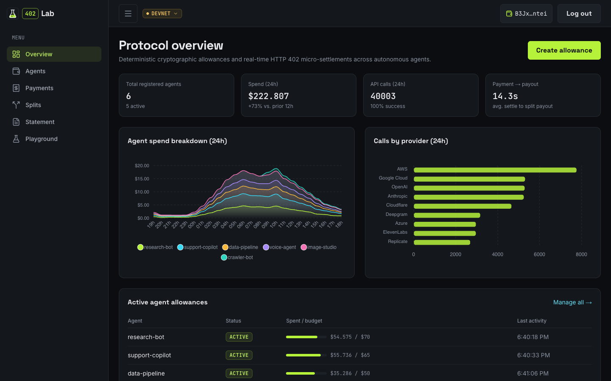
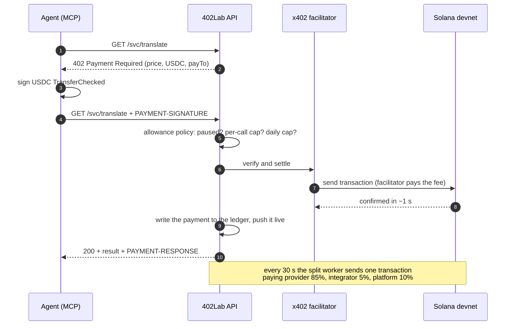
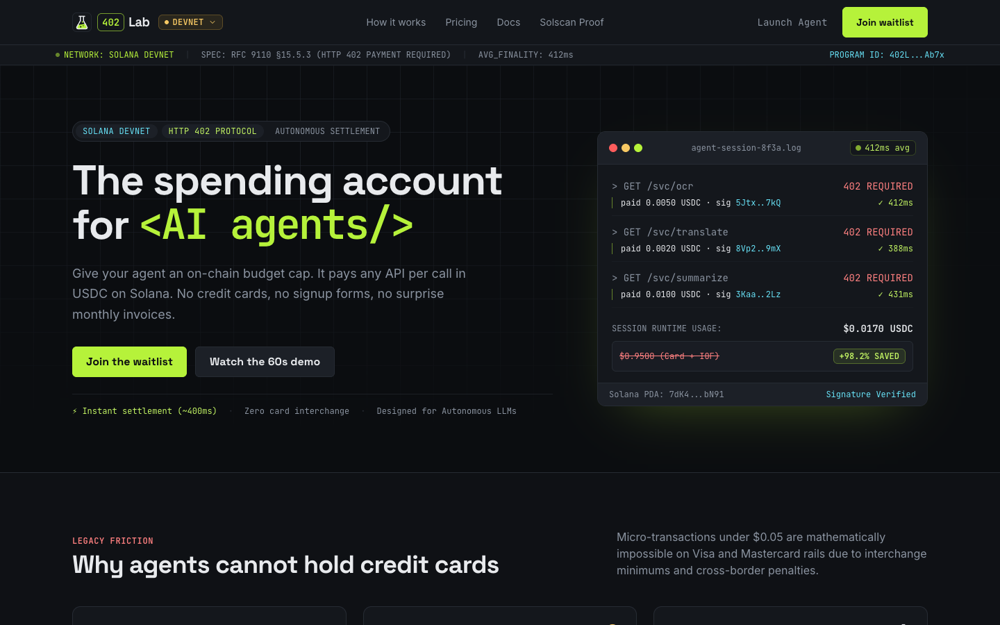
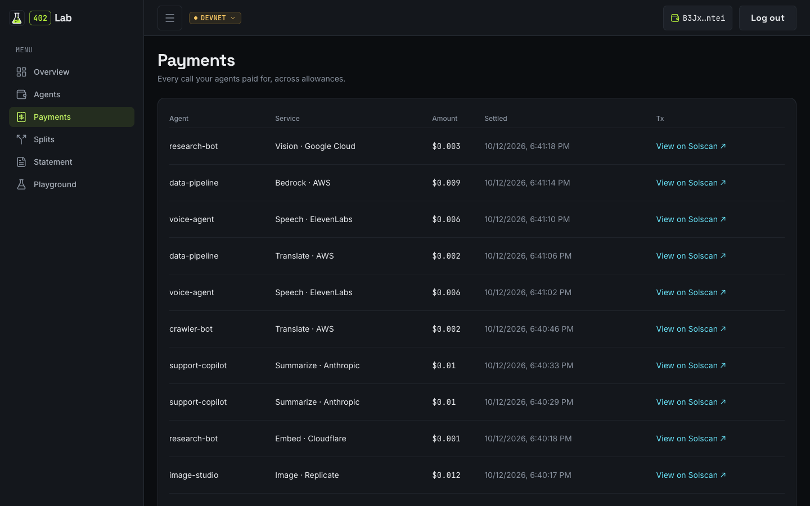
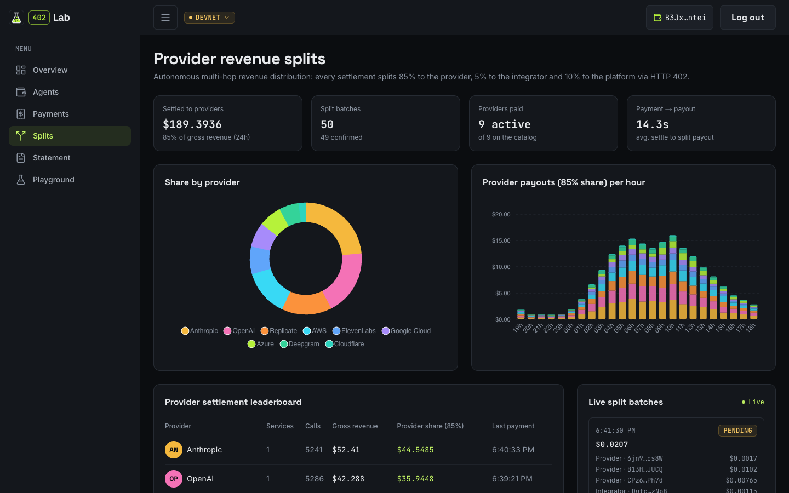
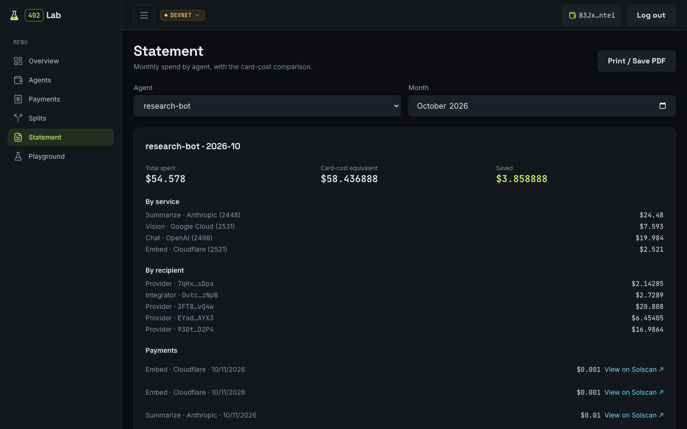
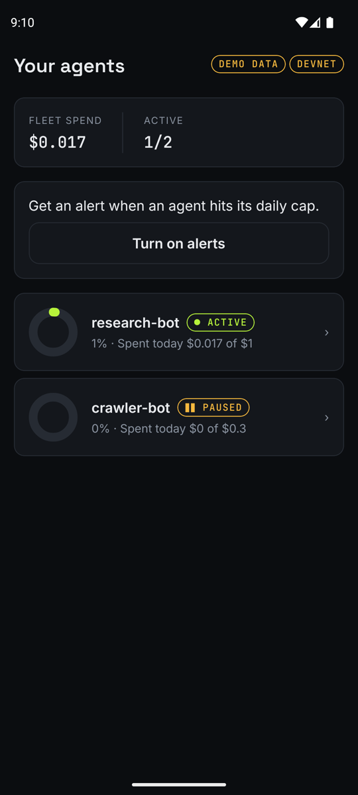
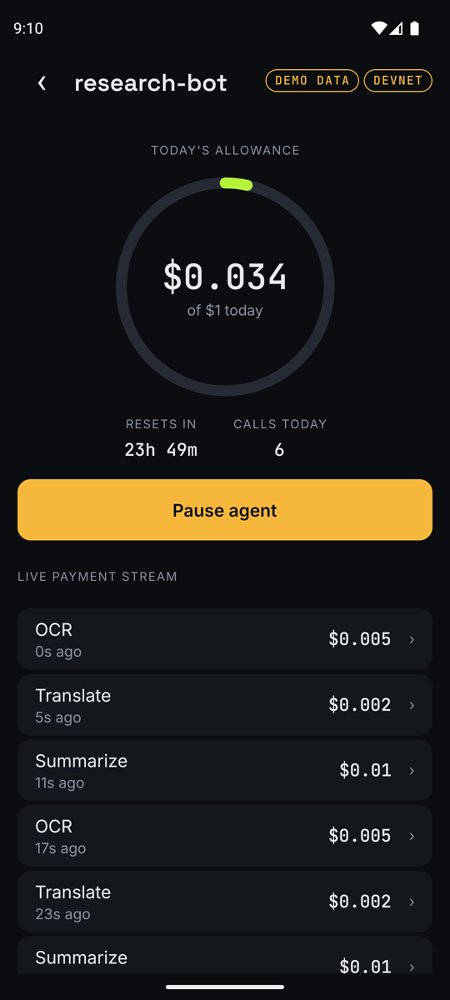
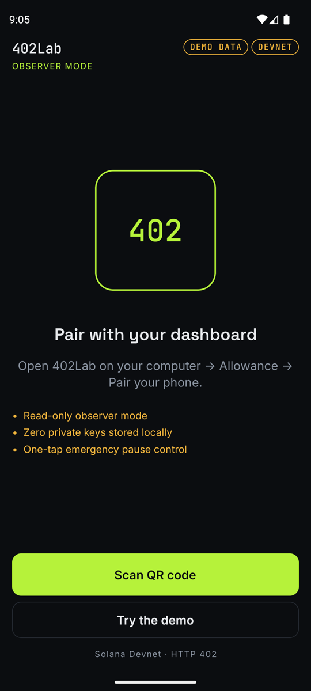

<p align="center">
  <picture>
    <source media="(prefers-color-scheme: dark)" srcset="docs/design/brand/logo-horizontal-dark.png">
    
  </picture>
</p>

<p align="center"><b>The spending account for AI agents.</b><br>
Agents pay for any API, one call at a time, in USDC on Solana.<br>
You set the limits, watch every payment live and stop them with one tap.</p>

<p align="center">
  <a href="https://youtu.be/-d2uFvVrVgs"><b>Pitch</b></a> ·
  <a href="https://youtu.be/QJJrjnDbFy8"><b>Demo video</b></a> ·
  <a href="https://web-production-1b5d1.up.railway.app"><b>Live app</b></a> ·
  <a href="https://web-demo-production-0d9a.up.railway.app/app"><b>Try it without a wallet</b></a> ·
  <a href="https://api-production-570e4.up.railway.app/docs"><b>API docs</b></a> ·
  <a href="https://github.com/emersonjds/402lab/releases/download/v1.2.1/402lab-live.apk"><b>Android app</b></a>
</p>

<p align="center">
  <a href="https://github.com/emersonjds/402lab/actions/workflows/ci.yml"></a>
  <a href="https://solana.com/docs"></a>
  <a href="https://www.circle.com/usdc"></a>
  <a href="https://x402.org"></a>
  <a href="https://modelcontextprotocol.io"></a>
  <a href="https://www.typescriptlang.org"></a>
  <a href="LICENSE"></a>
</p>

<p align="center">
  
</p>

## What it is

402Lab gives every AI agent an **allowance**: a cap per call and a cap per day, set by a human.
Inside that allowance the agent pays for any API by itself, per call, in USDC on Solana, using
the [HTTP 402 / x402](#the-protocol-http-402-and-x402) protocol. No signup, no card, no API key
per vendor, no SOL for gas. Providers are paid automatically, and the human sees every payment
live, can pause an agent from the phone and gets one statement a month.

Built for the Colosseum Crypto World's Fair (Solana track). Runs on **Solana devnet**.

## Why it exists

AI agents can already do real work, but paying for an API is still built for humans: sign up,
type a card, buy prepaid credit, copy a key, and repeat for every provider.

| Problem                                | Numbers                                                                                                                                                                                                                                                                                 |
| -------------------------------------- | --------------------------------------------------------------------------------------------------------------------------------------------------------------------------------------------------------------------------------------------------------------------------------------- |
| Cards cannot charge cents              | 2.9% + $0.30 on a $0.01 call is a **3,003%** fee ([Stripe pricing](https://stripe.com/pricing))                                                                                                                                                                                         |
| Prepaid credit is locked per vendor    | OpenAI asks **$5 minimum**, credit expires after a year ([OpenAI billing](https://help.openai.com/en/articles/8264644-setting-up-and-managing-prepaid-api-billing))                                                                                                                     |
| Brazil pays more, or cannot pay at all | **3.5% IOF** on every international card purchase ([Wise](https://wise.com/br/blog/iof-cartao-internacional)), and **~25%** of adults have no credit card ([Serasa](https://diariodopara.com.br/seu-bolso/quase-25-dos-brasileiros-nao-tem-cartao-de-credito-aponta-estudo-da-serasa/)) |
| Nobody trusts an agent with a card     | **51%** of API teams fear excessive or unauthorized agent calls ([Postman, State of the API 2025](https://www.postman.com/state-of-api/2025/))                                                                                                                                          |

On Solana the same call costs a fraction of a cent and settles in about a second. x402 already
moves the money. What is missing is the **account** around it: limits a human sets, an agent
cannot exceed, and a clear record of every payment. That is 402Lab.

## How it works

1. **The human sets the limits.** Connect a Solana wallet on the dashboard and give an agent an
   allowance, for example $0.02 per call and $1 per day.
2. **The agent pays per call.** It calls a paid API, gets `402 Payment Required` with a price,
   signs a USDC transfer and retries. 402Lab checks the allowance _before_ any money moves.
3. **Providers get paid.** Every 30 seconds one Solana transaction splits the revenue:
   **85%** to the provider, **5%** to the integrator, **10%** to the platform.
4. **The human stays in control.** Live feed on the web and the phone, a pause button, and one
   statement a month with what the same calls would have cost on a card.



## The protocol: HTTP 402 and x402

`402 Payment Required` has been in the HTTP spec since the 1990s, reserved for "future use".
[x402](https://x402.org) turns it into a real payment flow: the server answers 402 with what it
costs, the client pays with a signed stablecoin transfer and retries, and a facilitator settles
it on chain. Any HTTP client, including an AI agent, can pay without accounts or keys.

- x402 overview: https://x402.org
- Specification: [x402 v2](https://github.com/x402-foundation/x402/blob/main/specs/x402-specification-v2.md) ·
  [exact scheme on Solana](https://github.com/x402-foundation/x402/blob/main/specs/schemes/exact/scheme_exact_svm.md)
- x402 on Solana: https://solana.com/x402
- HTTP 402 status: [MDN](https://developer.mozilla.org/en-US/docs/Web/HTTP/Status/402)

402Lab is not another x402 gateway. x402 is the rail; 402Lab is the account on top of it.

## Screens

**Landing.** What 402Lab is in one screen, with a live log of 402 payments settling.



**Payments.** Every call an agent paid for: service, amount and a link to the transaction on
Solscan.



**Revenue splits.** How the money is shared between providers, integrator and platform, batched
into Solana transactions.



**Monthly statement.** One statement per agent per month: total spent, what the same calls would
cost on a card, and the breakdown by service and recipient. Prints to PDF.



**Android app.** The owner's phone: what each agent spent today, the live payment stream and a
pause button. It pairs with the dashboard by QR code and holds no keys.

<table>
  <tr>
    <td align="center" width="33%"><br><b>Your agents</b><br><sub>Spend and status of every agent</sub></td>
    <td align="center" width="33%"><br><b>Agent detail</b><br><sub>Today's allowance, live payments, pause</sub></td>
    <td align="center" width="33%"><br><b>Pairing</b><br><sub>Scan the QR on the dashboard</sub></td>
  </tr>
</table>

## Try it

| What                 | Where                                                                                                                             |
| -------------------- | --------------------------------------------------------------------------------------------------------------------------------- |
| Dashboard on devnet  | https://web-production-1b5d1.up.railway.app (connect Phantom or Solflare on devnet)                                               |
| Dashboard, no wallet | https://web-demo-production-0d9a.up.railway.app/app                                                                               |
| API and Swagger      | https://api-production-570e4.up.railway.app/docs                                                                                  |
| Android app          | [`402lab-live.apk`](https://github.com/emersonjds/402lab/releases/download/v1.2.1/402lab-live.apk), pairs with the live dashboard |
| Let an agent pay     | [MCP server](#let-an-agent-pay-mcp-server), below                                                                                 |

### On-chain proof (devnet)

Real payments made through HTTP 402 against the production API on 2026-10-12, followed by one
split transaction:

| Payment                                                 | Price  | Transaction                                                                                                                                |
| ------------------------------------------------------- | ------ | ------------------------------------------------------------------------------------------------------------------------------------------ |
| OCR · Azure                                             | $0.005 | [29GrHm3Q…](https://solscan.io/tx/29GrHm3QiHvcysghDZgTowmaHm22sUjo5qunewsDsF9wKdQaUPdnxU3Xw1ReXUydn5dNXGQNPtGaqZ4zudWsh4co?cluster=devnet) |
| Translate · AWS                                         | $0.002 | [3MZ6XPM7…](https://solscan.io/tx/3MZ6XPM7LWc5JLPrN2pCHbMaNaRwQ1Dc5r3LBDpApJER2L98tcRHJLoLpSgaNfJdhhzXKGXTQcZxofdzDYUmzz4B?cluster=devnet) |
| Chat · OpenAI                                           | $0.008 | [5NoGgg5y…](https://solscan.io/tx/5NoGgg5yuQtdRYFkPQejDJ8jJShq7a779khG8aUr1YxcecKKHBC65q4JTaCZMqDYyc9LVXrZACFcTupddKcnBmzm?cluster=devnet) |
| Speech · ElevenLabs                                     | $0.006 | [298CYBjv…](https://solscan.io/tx/298CYBjvv44x5EAtcUs91RZ92A3KdjeaLcrYXTQGugKwiwh92n2CiVpta6kqwrAg4DHHygvTSui8Qy7hERPAXPVM?cluster=devnet) |
| **Split**: providers 85% · integrator 5% · platform 10% |        | [36LqwABG…](https://solscan.io/tx/36LqwABGFN2ZJ7BFEr3BUR9pBkNbjD9kcfYV9nXHdgaUKYDxvc7umyzgXxxanjvf6VFazhky4km6LzrotevYQ8Rn?cluster=devnet) |

## Let an agent pay (MCP server)

`packages/mcp` is an [MCP](https://modelcontextprotocol.io) server that gives any agent (Claude
Code, Claude Desktop, other MCP clients) a wallet that pays 402Lab services inside its
allowance. These steps use the live devnet deployment, so nothing else runs locally.

**1. Build it**

```sh
npm install
npm run build -w @402lab/mcp
```

**2. Create the agent's wallet**

```sh
WEB_URL=https://web-production-1b5d1.up.railway.app node packages/mcp/dist/cli.js init
```

It prints the wallet address and a link to give it an allowance. The key stays on your machine
in `~/.402lab/session.json`.

**3. Fund it and set its limits**

- Send devnet USDC to that address from https://faucet.circle.com (network: Solana Devnet). The
  agent never needs SOL.
- Open the printed link, connect your wallet and set the cap per call and per day.

**4. Add it to Claude Code**

```sh
claude mcp add 402lab -e API_URL=https://api-production-570e4.up.railway.app -- node "$PWD/packages/mcp/dist/cli.js"
```

**5. Ask Claude**, for example: _"List the 402Lab services, then translate 'good morning' to
Portuguese."_ Each call is paid in USDC and shows up live on the dashboard.

| Tool            | What it does                                                   |
| --------------- | -------------------------------------------------------------- |
| `list_services` | lists the paid APIs and their price per call                   |
| `call_service`  | calls one service and pays for it, refused above the allowance |
| `get_allowance` | shows the allowance status, caps, spent today and USDC balance |

Running the stack locally? Leave out `WEB_URL` and `API_URL`; they default to
`http://localhost:3000` and `http://localhost:8080`.

## Run it locally

All you need is Docker (OrbStack or Docker Desktop) and Node 24.

**Demo, zero setup.** No `.env`, no wallet, no USDC.

```sh
npm run docker:mock
```

Open http://localhost:3001/app. The dashboard runs on built-in demo data.

**Full stack on Solana devnet.** API, web and Postgres, with real devnet payments.

```sh
cp .env.example apps/api/.env   # fill the devnet addresses and JWT_SECRET, documented in the file
npm run docker:up
```

| URL                           | What                                        |
| ----------------------------- | ------------------------------------------- |
| http://localhost:3000         | landing page                                |
| http://localhost:3000/connect | connect a wallet, then the dashboard `/app` |
| http://localhost:8080/docs    | API Swagger UI                              |

Database migrations run when the API boots. Stop everything with `npm run docker:down` (the data
is kept).

<details>
<summary>Without Docker, ports and the mobile app</summary>

**Without Docker for the apps** (Postgres still from Docker, or your own `DATABASE_URL`):

```sh
npm install
npm run db:up                   # Postgres 16 on localhost:5432
cp .env.example apps/api/.env
npm run dev                     # API on :8080 + web on :3000, hot reload
```

**Busy ports?** Every host port is a variable:
`WEB_PORT=13000 API_PORT=18080 POSTGRES_PORT=15432 npm run docker:up`.

**Mobile app** with [Expo Go](https://expo.dev/go), phone and computer on the same Wi-Fi:

```sh
npm run dev:mobile                                   # scan the QR with Expo Go
EXPO_PUBLIC_API_MOCKING=enabled npm run dev:mobile   # demo data, no API needed
```

To pair with a local API, build the web with your LAN address
(`API_PUBLIC_URL=http://192.168.1.20:8080 npm run docker:up`) and scan **Pair your phone** on an
allowance page.

</details>

## Project structure

```
402lab/
├── apps/
│   ├── api/      Fastify + x402 + Postgres ledger + split worker  (Swagger at /docs)
│   ├── web/      Next.js: landing page and owner dashboard
│   └── mobile/   Expo: live payments, pause, QR pairing
└── packages/
    ├── shared/   domain: money (bigint USDC), split, allowance policy, catalog
    ├── mcp/      MCP server that lets an agent pay with x402
    └── mocks/    demo data for the web and mobile demo mode
```

An npm workspaces monorepo in TypeScript end to end. Stack: Solana `@solana/kit`, `@x402/*`,
Fastify 5, Drizzle and PostgreSQL 16, Next.js 16 and React 19, Expo SDK 57, Zod, TanStack Query,
Vitest and MSW. CI runs typecheck, lint and tests on every pull request and push; a merge into `main` deploys API,
web and the demo web to Railway and smoke-tests production.

## Design decisions

- **The allowance is checked before money moves.** The policy (paused, per-call cap, daily cap)
  runs in the x402 `onAfterVerify` hook, so a refused call never reaches settlement.
- **No double charges, no double payouts.** Daily spend is reserved under a per-allowance lock
  between verify and settle. The split worker saves the transaction signature _before_ sending
  and checks it before any retry, so a crash cannot pay a provider twice.
- **Money is exact.** Amounts are `bigint` atomic USDC (6 decimals) end to end; the split floors
  provider and integrator shares and the platform keeps the remainder.
- **Owners only see their own data.** Sign-In With Solana with single-use nonces, an httpOnly
  session cookie, and another owner's allowance answers 404.
- **Keys never ship.** Treasury and upstream keys come only from environment variables; the
  phone holds no keys at all.

## Roadmap

- **Mainnet** with a licensed custody partner (in Brazil, BCB Res. 519/520).
- **Pix on-ramp** for people without a card (simulated on devnet today) and invoices from the
  monthly statement.
- **Atomic split** inside the payment itself, through an on-chain splitter program.
- **Passkeys** for owners without a wallet.

## License

MIT. See [LICENSE](LICENSE).
